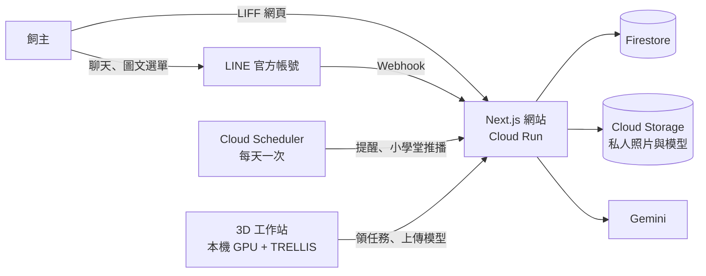

# 從此有你

**用 AI 支持終養不棄養的飼主 LINE 平台**

從決定要不要養、照顧牠一輩子，到最後好好說再見，「從此有你」陪飼主走完和毛孩相處的每個階段。整個服務放在一個 LINE 官方帳號裡，不用另外下載 App。

> 2026 Royal Canin AI for Pets 參賽作品，主題「相遇：負責任的飼主」。

- 網站：https://langlang-partner-170619611244.asia-east1.run.app
- 示範帳號（虛構資料，不用登入）：https://langlang-partner-170619611244.asia-east1.run.app/demo
- LINE 官方帳號：搜尋 `@924ebszw`

## 為什麼要做

很多貓狗不是一開始就被放棄，而是在生活改變時：搬家找不到能養的房子、家裡有了寶寶、出國、經濟變緊、牠老了生病了。「從此有你」把力氣放在三個時間點：

1. **養之前**：先想清楚時間、經濟、住處、家人和自己的未來。
2. **養的時候**：在對的時候提醒、教飼主該知道的事，生活變動時給一步步的準備清單。
3. **告別時**：用照片為牠做一個 3D 紀念。

## 功能

### 相遇之前：飼養前評估

- 15 題，涵蓋時間、經濟、居住、家庭、未來與動機、支援六個面向。
- 準備度分數和風險由**固定規則**計算，每一分怎麼來都看得到；AI 只負責把結果寫成白話報告。
- 依生活條件建議適合的類型（種類、體型、年齡、活動量），不推薦個別動物。
- 依貓、小型犬、中型犬、大型犬估算一輩子的花費，並列出計算依據。

### 相守的日子

- **生活變動檢查**：搬家、懷孕、出國、工作變忙、經濟變緊等 8 種變動，回答 7 題就拿到分「現在／變動前／變動後」的準備清單。填了日期，會在一週前用 LINE 提醒。在聊天室打「我要搬家」也會帶到這裡。
- **照顧日曆**：驅蟲、疫苗、健康檢查依年紀建議間隔，到期前一天 LINE 推播，按「完成了」自動算出下一次。
- **飼主小學堂**：21 堂課，依毛孩的**月齡**和**季節**排課。疫苗、結紮、老年健檢這類有時機的課，到了就主動推；颱風、寒流、過年鞭炮這類季節課每年會再出現。每課附一題在聊天室就能作答的小測驗。
- **拍醫療單據**：在 LINE 傳診斷書、收據或藥袋照片，AI 照原文整理成紀錄，解釋看不懂的名詞，確認後才存檔；有回診日會在前一天提醒。也會依過去一年的醫療花費，建議每月存多少醫療預備金。

### 好好說再見：紀念與告別

- 毛孩離開後，用飼主手機裡的照片，以 [Microsoft TRELLIS](https://github.com/microsoft/TRELLIS) 重建牠的 3D 模型。
- 模型會呼吸、搖尾巴、轉頭；可以用手機 AR 以真實大小放在身邊。
- AI 依飼主寫下的回憶寫一段紀念文，飼主確認後才顯示。
- 3D 重建在另一台有顯示卡的電腦上執行，程式在 [cong-ci-you-ni-3d-lab](https://github.com/Joe456789/cong-ci-you-ni-3d-lab)。

## AI 怎麼用、怎麼把關

| 用在哪裡 | AI 做什麼 | 不交給 AI 的部分 |
|---|---|---|
| 飼養前評估 | 把規則結果寫成白話報告和準備事項 | 分數、風險、結論 |
| 生活變動檢查 | 寫一段話，點出最該先做的一件事 | 風險程度、準備清單 |
| 醫療單據 | 讀照片，照原文整理欄位、解釋名詞 | 任何診斷、治療或用藥判斷 |
| 紀念與告別 | 依回憶寫紀念文 | 飼主確認前不顯示 |
| 3D 紀念 | 從照片重建 3D 模型（TRELLIS） | — |

- AI 使用 Google Gemini。所有輸出都經過規則檢查（`lib/ai/guard.ts`），出現診斷、用藥、保證健康這類字眼就重寫，仍不通過就不顯示，改用規則結果。
- 小學堂的課程和生活變動清單都是固定內容，測試會檢查每一段文字都沒有這類字眼。
- 牽涉健康時一律請飼主諮詢獸醫，每個相關畫面都附上獸醫提示。
- AI 用量有全平台和每位飼主的每月上限。

> 本作品提供之資訊僅供輔助參考，不能取代獸醫師之診斷、治療或專業建議。

## 架構



- **前端與後端**：Next.js 16（App Router、Server Actions）、React 19、TypeScript
- **登入**：LINE LIFF，網頁用 LINE 的 ID token 換成網站的登入狀態
- **資料**：Firestore；沒有設定 Google Cloud 時自動改用本機檔案（`.data/`）
- **檔案**：Cloud Storage，飼主的照片、單據和模型只有本人或帶伺服器簽章的連結能讀
- **AI**：Gemini（文字與讀圖）、TRELLIS（3D 重建）
- **3D 顯示**：three.js、model-viewer
- **測試**：vitest

## 專案結構

```
app/            頁面、Server Actions、API（LINE webhook、排程、3D 工作站）
components/     畫面元件
lib/
  readiness.ts    飼養前評估的計分規則
  lifeChange.ts   生活變動檢查的規則和清單
  lessons.ts      小學堂的課程和排課
  care.ts         照顧日曆
  records.ts      醫療紀錄和醫療預備金
  lifetimeCost.ts 一輩子花費估算
  ai/             Gemini 呼叫和健康宣稱檢查
  line/           LINE 訊息、圖文選單、對話流程
  db/             Firestore 和本機檔案兩種資料庫
demo/           示範帳號的虛構資料
scripts/        LINE 設定、示範資料、圖文選單圖片
tests/          規則和 LINE 對話流程的測試
```

## 在本機執行

需要 Node.js 22 以上。

```bash
npm install
cp .env.example .env.local
npm run dev:local
```

`npm run dev:local` 是 Windows 的寫法；macOS 或 Linux 改用 `LL_LOCAL_DATA=1 npm run dev`。

打開 http://localhost:3100。資料存在 `.data/`，第一次啟動會自動放入示範帳號；需要登入的頁面可以用「本機測試登入」。沒有填 `GEMINI_API_KEY` 時，網站照常運作，AI 的部分會顯示規則結果。

```bash
npm test
```

LINE 官方帳號、LIFF、部署到 Cloud Run 和 3D 工作站的設定步驟，請看 [SETUP.md](SETUP.md)。

## 資料與隱私

- 所有金鑰只放在 `.env.local` 和 Cloud Run 的環境變數，不在這個儲存庫裡。
- 示範帳號、示範單據和示範醫院都是虛構的。
- 處理真實飼主資料（尤其醫療單據）時，Gemini 要使用付費方案，免費方案的輸入可能被用來改善產品。

## 版本

舊的「浪浪夥伴」收容所版本保留在 git 標籤 `shelter-version`。
